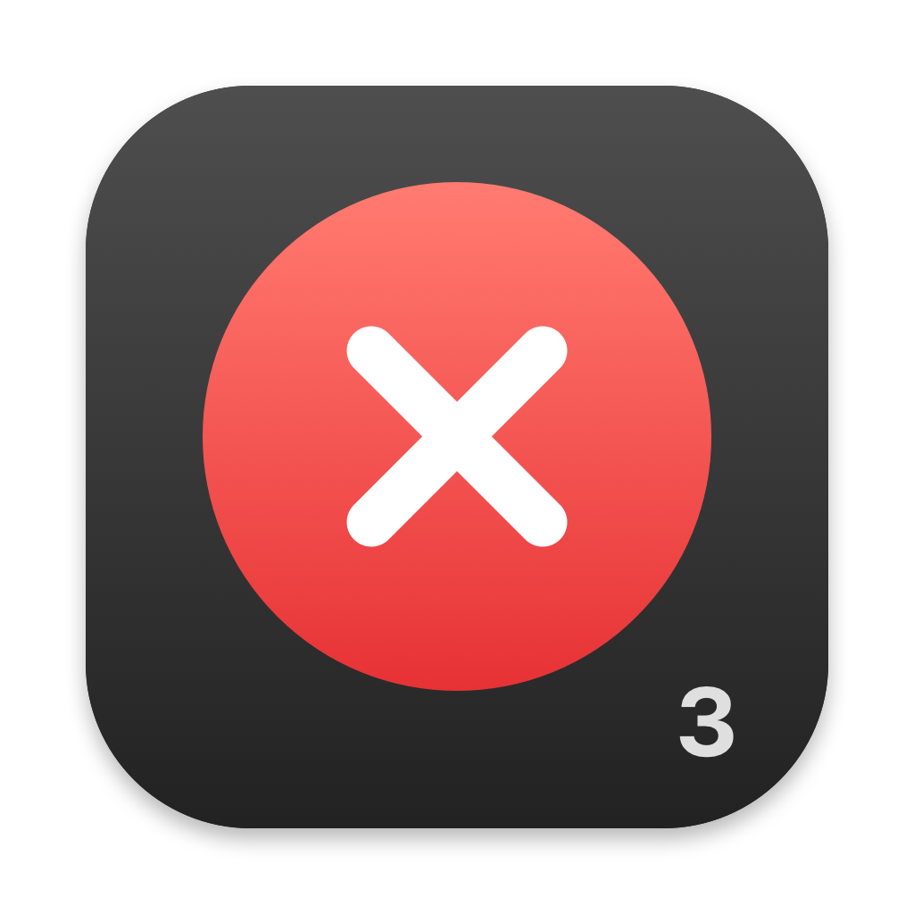

# RedQuits3



A small native macOS menu-bar utility: **click any window’s red close button to quit the entire app**, even if its other windows are still open. A normal quit request is used, like ⌘Q. Never force-quit.

Inspired by the classic RedQuits utility by Carsten Mielke. This is an independent implementation, not an official update. No original RedQuits code, binaries, or artwork are included.

## Requirements

- Apple Silicon Mac, macOS 13 or newer
- Xcode Command Line Tools (`xcode-select --install`) to build
- Accessibility permission to detect close-button clicks

Verified on macOS 27.0.1 with Safari and a two-window test fixture. Other macOS versions and applications have not been exhaustively tested.

## Build and install

```sh
git clone https://github.com/wzygadlo/RedQuits3.git
cd RedQuits3
./build.sh
./dist/RedQuits3.app/Contents/MacOS/RedQuits3 --selftest
cp -R dist/RedQuits3.app /Applications/
open /Applications/RedQuits3.app
```

Enable **RedQuits3** in **System Settings → Privacy & Security → Accessibility**. It stays running while waiting for permission. Its monochrome menu-bar icon is dimmed when disabled or permission is missing; hover for status or click to enable/disable or quit.

Locally built apps are **ad-hoc signed, not Apple-notarized**. After rebuilding/replacing the app, you may need to remove and re-add `/Applications/RedQuits3.app` in Accessibility. No signing keychain or signing password is used. Quit the existing app before replacing it.

## Behavior and limits

- The window’s own title-bar close button is captured through Accessibility on mouse-down, before the window disappears. Releasing inside it requests that the whole app quit.
- While an app has a child window open (a dialog, sheet, Settings or About window, inspector or other panel), its close buttons only close windows and the app keeps running. That includes the child window’s own close button. Panels an app hides while it’s in the background don’t count.
- Command-W, minimizing, and dragging off the close button do not trigger a quit.
- Save prompts remain under the target app’s control; cancelling cancels the quit. There is no force-quit or timed retry.
- Finder and system infrastructure are protected. Apps that don’t expose their close button through Accessibility, or don’t answer within half a second (for example, while hung), are left alone.
- Quitting stops an app’s background work too. Exclude music, messaging, download, or other apps you want kept running.
- The app has no network code or telemetry. Accessibility permission is powerful: build and run code you trust.

## Configuration

Edit `~/Library/Application Support/RedQuits3/config.json`, then relaunch:

```json
{
  "enabled": true,
  "excludedApps": ["com.apple.finder"]
}
```

Settings you leave out keep their defaults. If RedQuits3 can’t read the file, auto-quit stays off and the file is left untouched: fix or delete it, then relaunch.

When upgrading from the local RedQuits2 prototype, quit it first. Copy its `config.json` from `~/Library/Application Support/RedQuits2/` into the new settings folder if you want to preserve your exclusions. Only run one version at a time.

## Checks and diagnostics

`--selftest` checks settings loading, exclusions, click-release validation and child-window detection without altering user settings. A failure names the check that failed.

`Tests/WindowFixture.swift` is a disposable two-window app for integration checks; keep it out of the main app. RedQuits3 ignores apps without a bundle identifier, so build it with `Tests/build-fixture.sh`, which wraps it in `dist/WindowFixture.app`. Run that after `./build.sh`, which clears `dist/`. Then start the fixture with an output path first:

```sh
dist/WindowFixture.app/Contents/MacOS/WindowFixture /tmp/fixture.json --child-window
```

The output file records the close buttons’ screen coordinates.
- **Without flags:** closing either window should quit the fixture, which logs `FIXTURE: quit accepted`.
- **`--child-window`:** adds a Settings-style window, so no close button should quit it.
- **`--refuse-quit`:** simulates cancelling a save prompt.

For click diagnostics, quit the menu-bar app and run:

```sh
RQ3_DEBUG=1 /Applications/RedQuits3.app/Contents/MacOS/RedQuits3
```

Debug output names apps you click; don’t share it without checking its contents.

## Icons

Original app and menu-bar artwork is included in `Assets/`. To regenerate it using only the macOS SDK:

```sh
swift Scripts/GenerateIcons.swift
iconutil -c icns Assets/RedQuits3.iconset -o Assets/RedQuits3.icns
```

## Future changes

The GitHub repository is the source of truth. Build and run the self-check before committing changes. Never commit access tokens, settings, signing keys, or generated app bundles.

## Uninstall

Quit RedQuits3, move `/Applications/RedQuits3.app` to the Trash, and remove its Accessibility entry. Optionally delete `~/Library/Application Support/RedQuits3/` to remove settings, and `~/.redquits3.lock`, its single-instance lock file.

## License

[MIT](LICENSE), copyright © 2026 Wojtek Zygadlo. Covers this project’s code and original icons only; the original RedQuits remains its author’s property.
