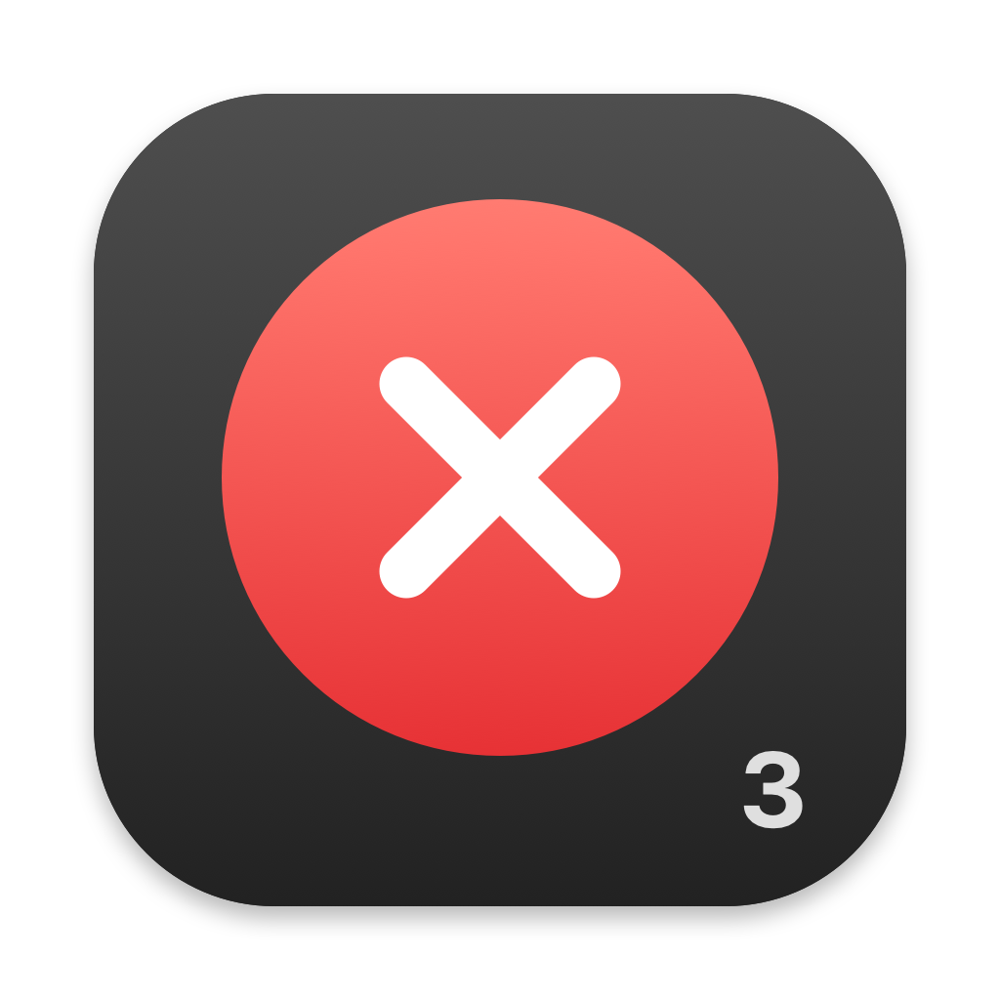

# RedQuits3



A small native macOS menu-bar utility: **click any window’s red close button to quit the entire app**, even if its other windows are still open. A normal quit request is used, like ⌘Q. Never force-quit.

Inspired by the classic RedQuits utility by Carsten Mielke. This is an independent implementation, not an official update. No original RedQuits code, binaries, or artwork are included.

## Requirements

- Apple Silicon Mac, macOS 13 or newer
- Xcode Command Line Tools (`xcode-select --install`) to build
- Accessibility permission to detect close-button clicks

Verified on macOS 27.0.1 with Safari and a two-window test fixture. Other macOS versions and applications have not been exhaustively tested.

## Build and install

```sh
git clone https://github.com/wzygadlo/RedQuits3.git
cd RedQuits3
./build.sh
./dist/RedQuits3.app/Contents/MacOS/RedQuits3 --selftest
cp -R dist/RedQuits3.app /Applications/
open /Applications/RedQuits3.app
```

Enable **RedQuits3** in **System Settings → Privacy & Security → Accessibility**. It stays running while waiting for permission. Its monochrome menu-bar icon is dimmed when disabled or permission is missing; hover for status or click to enable/disable or quit.

Locally built apps are **ad-hoc signed, not Apple-notarized**. After rebuilding/replacing the app, you may need to remove and re-add `/Applications/RedQuits3.app` in Accessibility. No signing keychain or signing password is used. Quit the existing app before replacing it.

## Behavior and limits

- The actual Accessibility close-button frame is captured on mouse-down, before the window disappears. Releasing inside it requests that the whole app quit.
- Command-W, minimizing, and dragging off the close button do not trigger a quit.
- Save prompts remain under the target app’s control; cancelling cancels the quit. There is no force-quit or timed retry.
- Finder and system infrastructure are protected. Apps that don’t expose their close button through Accessibility are left alone.
- Quitting stops an app’s background work too. Exclude music, messaging, download, or other apps you want kept running.
- The app has no network code or telemetry. Accessibility permission is powerful: build and run code you trust.

## Configuration

Edit `~/Library/Application Support/RedQuits3/config.json`, then relaunch:

```json
{
  "enabled": true,
  "excludedApps": ["com.apple.finder"]
}
```

When upgrading from the local RedQuits2 prototype, quit it first. Copy its `config.json` from `~/Library/Application Support/RedQuits2/` into the new settings folder if you want to preserve your exclusions. Only run one version at a time.

## Checks and diagnostics

`--selftest` checks configuration serialization, exclusions, and click-release validation without altering user settings. `Tests/WindowFixture.swift` supplies two disposable windows for integration checks. Its `--refuse-quit` flag simulates cancelling a save prompt; compile it separately, not into the main app.

For click diagnostics, quit the menu-bar app and run:

```sh
RQ3_DEBUG=1 /Applications/RedQuits3.app/Contents/MacOS/RedQuits3
```

Debug output names apps you click; don’t share it without checking its contents.

## Icons

Original app and menu-bar artwork is included in `Assets/`. To regenerate it using only the macOS SDK:

```sh
swift Scripts/GenerateIcons.swift
iconutil -c icns Assets/RedQuits3.iconset -o Assets/RedQuits3.icns
```

## Future changes

The GitHub repository is the source of truth. Build and run the self-check before committing changes. Never commit access tokens, settings, signing keys, or generated app bundles.

Public pull requests are welcome, but changes to `main` require approval from `@wzygadlo`, the code owner for every file. New commits dismiss previous approvals. The repository owner retains GitHub's administrator override for their own changes.

## Uninstall

Quit RedQuits3, move `/Applications/RedQuits3.app` to the Trash, and remove its Accessibility entry. Optionally delete `~/Library/Application Support/RedQuits3/` to remove settings.

## License

[MIT](LICENSE), copyright © 2026 Wojtek Zygadlo. Covers this project’s code and original icons only; the original RedQuits remains its author’s property.
